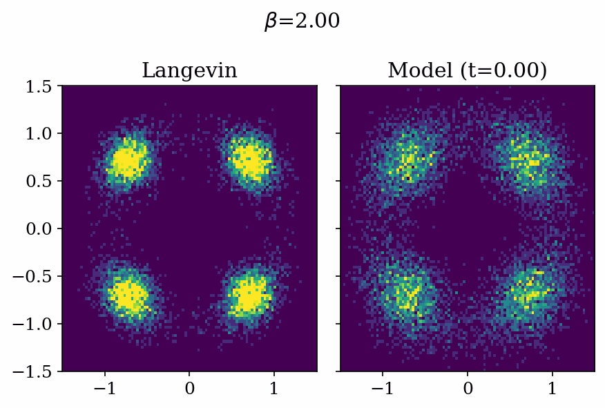

# Thermodynamic Interpolation for underdamped Langevin Dynamics


This repository contains the source code for *the Consistent projection of Langevin dynamics: Preserving thermodynamics
and kinetics in coarse-grained models* paper. 

The code was initially published on Zenodo:

[](https://doi.org/10.5281/zenodo.13808937)


## Environment setup

To set up the environment, make sure `uv` is installed on your system. Then run the following command in your terminal:
```bash
uv sync
```

Next, you need to activate the environment by running:
- macOS/Linux:
```bash
source .venv/bin/activate
```
- Windows:
```bash
.venv\Scripts\activate
```

## Main scripts
The results are generated via two scripts: `lemon_uld.py` and `lemon_uld_diffmass.py`. The first script allows you to generate datasets and do the analysis of the timescales based on the *gEDMD* algorithm. There is a config file called `setting_gedmd.json` that contains the parameters for the analysis. You can modify the parameters in this file to adjust the settings for your analysis and they are defined as follows:
- beta: inverse temperature $\beta$
- dt: time step for the simulation
- mass: whether `equalmass` or `diffmass`. The script `lemon_uld.py` is for the case of `equalmass`. To generate only the Figure 4 in the paper, you need to set mass to `diffmass` and run the script `lemon_uld_diffmass.py`.
- data_mode: whether to use underdamped Langevin dynamics data `uld` or generated data from the TI model `genai` or generated samples based on rejection sampling scheme `rs` for all analyses.
- integration_length: length of the integration for CG SDEs.
- data_path: path to store/load the data.
- new_data: whether to generate new data or use existing data
Analyses:
- vamp_score_analysis: whether to perform VAMP score analysis. This is used to optimize the hyperparameters for the RFF basis functions.
- gedmd_analysis: whether to perform gEDMD analysis to compute the timescales of CG dynamics.
- old_analysis: whether to perform the analysis based on the previous work using overdamped Langevin dynamics.
- eff_dyn_learning: whether to perform the learning of the effective dynamics.
- gedmd_analysis_learned: whether to perform gEDMD analysis on the learned effective dynamics.
- integration: whether to use Euler-Maruyama to integrate the learned CG stochastic differenttial equations.
- integ_analysis: whether to perform the gedmd analysis on the integrated data from the learned CG SDEs.
- EDMD_CGspace: whether to perform EDMD analysis on the CG data.
- EDMD_fullspace: whether to perform EDMD analysis on the full space data.

Keep in mind that in case you run `lemon_uld_diffmass.py`, you can only perform `EDMD_CGspace` and `gedmd_analysis` analyses. The other analyses are only implemented for the case of equal masses.
## Training the TI model
Once the dataset has been generated, you can train the TI model by running
```bash
python trainer.py
```

By default, the script uses the run settings specified in `setting_ti.json`. You can change the parameters in the JSON file to adjust the training settings. The script will save model checkpoints at every epoch (folder can be specified in the JSON file).

To enable logging to Weights and Biases, you can set the `use_wandb` key in the JSON file to `1`. This will log the training process to your Weights and Biases account. Make sure to have Weights and Biases installed and logged in before running the script.

### Stochastic Interpolants

The flow model will be trained using Stochastic Interpolants. For further information on the method, please see [Stochastic Interpolants: A Unifying Framework for Flows and Diffusions](https://arxiv.org/abs/2303.08797).

## Sampling with the TI model
To sample using a trained model, you can run
```bash
python sampler.py
```

To set which model is used, specify the keys `sampling_model` and `sampling_epoch` in the JSON file. Optionally, you can also set `return_dlogp=1` to return the change in log probability between the initial conditions and the samples. 

Once the samples have been generated, they will be stored in the directory `.results` (or a different directory if specified so in the settings file). 

## Plotting the results
Running the above scripts will generate the results for all analyses and store them in the folder `.results` (or a different directory if specified so in the settings file). By running 
```
python plots.py
```
you can plot the all results according to the ones shows in the paper. Some figures are based on the value of `beta` defined in `setting_gedmd.json` that must be either `1` or `2`. 

## Important notes
- The results for all analyses are stored in the folder `.results` (or a different directory if specified so in the settings file). If you only want to regenerate figures, you can directly run the plotting script without running the other scripts.
- Some of the analyses are built on top of each other, so make sure to run the scripts in the same order explained above. If you run certain analyses, you will overwrite the previous results for those analyses. In order to avoid any errors, perform all analyses to have consistent results.


## Citation
If you use this code for your research, please cite the following [paper](https://journals.aps.org/pre/abstract/10.1103/wckl-dz9d):

Nateghi, V., Neureither, L., Moqvist, S., Hartmann, C., Olsson, S., & Nüske, F. (2026). Consistent projection of Langevin dynamics: Preserving thermodynamics and kinetics in coarse-grained models. Physical Review E, 113(5), 055308.

